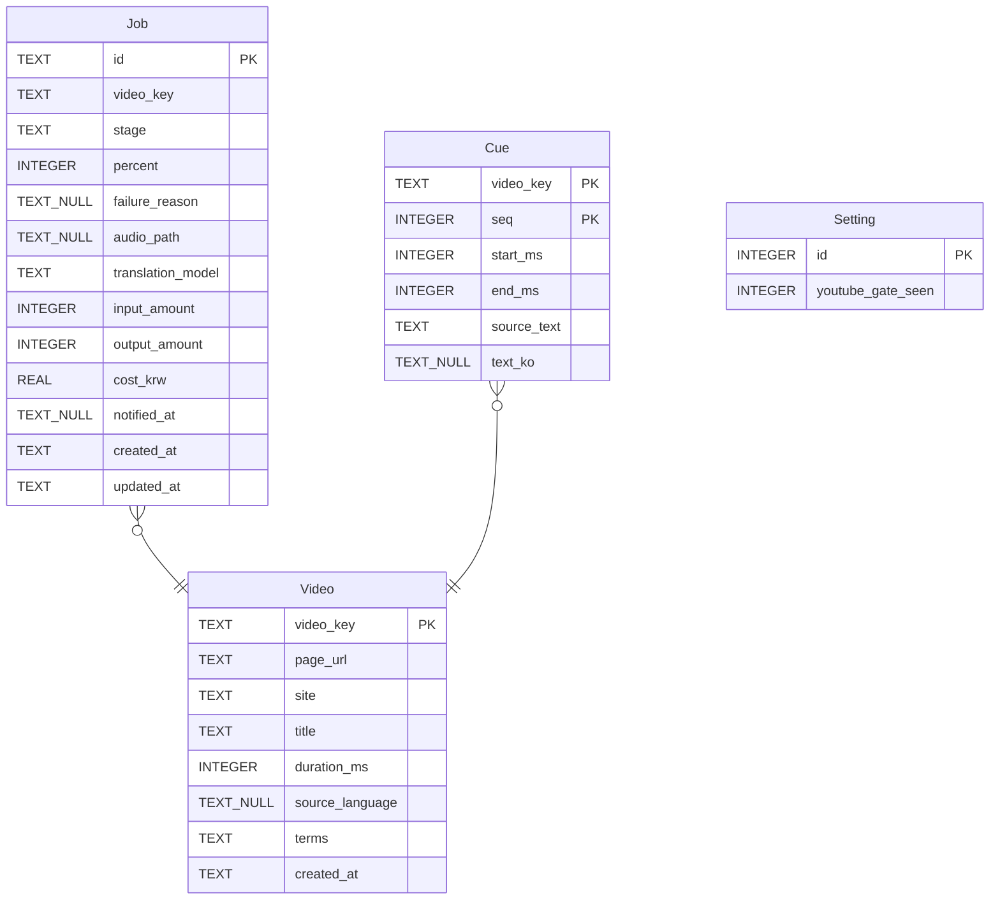
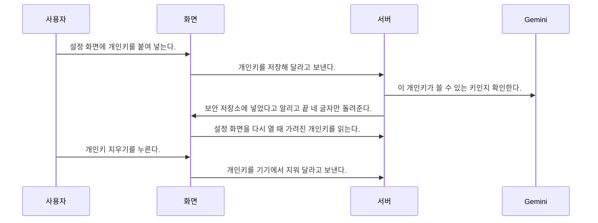
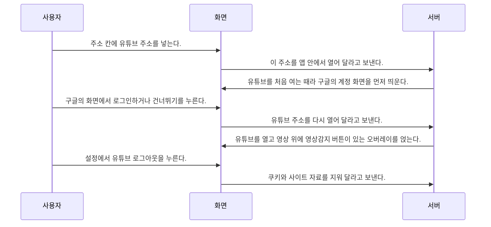
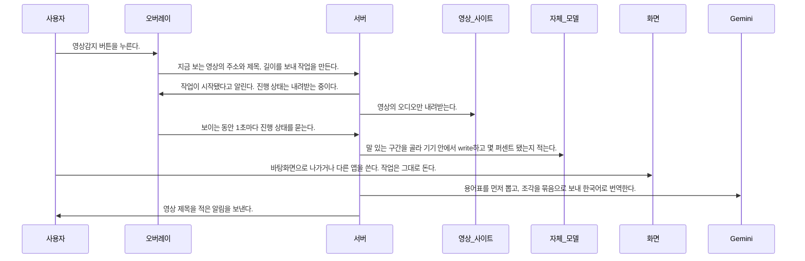
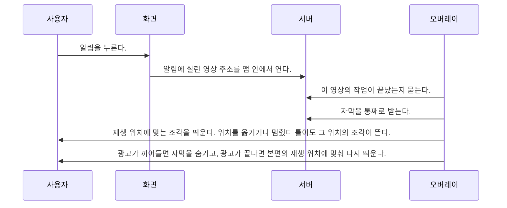
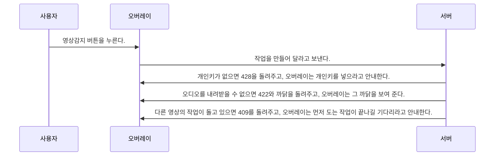
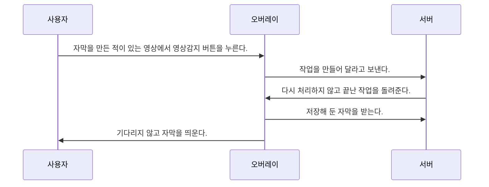

# 백엔드 설계 — video-translate-overlay-2

> 외국어로 된 영상을 한국어로 실시간 번역 해주는 앱을 만들고 싶어.
(유튜브가 그런곳에 오버레이를 씌우는 형식으로.)

이때, 모바일용으로도 잘 되어야해. 그래서 rust를 기반으로 웹 프레임 워크를 구상해줘야해.(각종 최적화 때문)

번역 모듈은 gemini-3.1-flash-lite를 기본으로 쓰고, 비용절감을 해야해.

그리고 오디오에 입력되는 외국어를 토대로 자체 모델로 write시키고, 그것을 번역하는 구조야.
이때, 밀림 현상이 있어서는 안돼.

굳이 이렇게 하는 이유는, gemini에도 자막을 바로 한국어로 변환하는게 있는데, 너무 비싸.
그래서 1시간에 1000원 내외로 싸면서도 좋은 번역을 하는것이야.

즉, 구조는 다음과 같아.
- 사용자가 번역하고 싶은 오버레이에서 영상감지 버튼을 누름.
- 영상을 자동으로 다운 받고(오디오 형식으로), 그 목소리를 감지하여 write를 함
- 그걸 토대로 자막을 맞춤.
- 사용자한테 알림

이때 영상 감지를 한 이후에는(영상을 다운 받고 난 다음에는) 유저는 바탕화면에 나가거나 백그라운드에서도 너가 만들어야함.

일단 구체적인 용도로는 딥러닝이나 그런 기술 강연/강의를 간편하게 자막으로 보는 기능이야.(유튜브 자막은 너무 비정확해.)

후에 확장으로는, qwen같은 걸로 화자의 목소리를 내가 원하는 목소리(내 최애의 목소리)로 강연을 들어서, 딴짓하면서 강의 듣기 좋게 하는거야.(왜 이런 아이디어가 나왔냐하면, 대부분 강의는 너무 지루해. 그래서 내가 좋아하는 최애의 목소리로 강의를 들으면 더 집중이 잘되지 않을까? 하는 아이디어에서 착안된거야.)

참고로 테스트 핸드폰 기종은 갤럭시 s21 울트라야.

외국어로 된 딥러닝·기술 강연/강의 영상을 한국어 자막으로 보여 주는 실시간 번역 앱을 만듭니다. 유튜브 같은 곳에 씌운 오버레이에서 영상감지 버튼을 누르면 영상을 오디오로 내려받아 자체 모델이 목소리를 write하고, gemini-3.1-flash-lite가 그 글을 번역해 밀림 현상 없이 자막을 맞춘 뒤 알림을 보냅니다. Rust 기반 웹 프레임워크로 짜서 모바일(테스트 기종 갤럭시 S21 울트라)에서도 잘 돌고, 영상감지 뒤에는 바탕화면으로 나가거나 백그라운드에 있어도 작업이 이어지며, 비용은 1시간에 1000원 내외로 맞춥니다.

## 스택

요구 대화에서 고른 것이다. 바꾸려면 새 실행을 시작한다.

| 부분 | 고른 것 | 이유 |
| --- | --- | --- |
| 백엔드 | Rust + Tauri 2 (Cargo) | 주인이 최적화를 이유로 Rust 기반을 요구했고, 같은 Rust 코드로 안드로이드 앱과 윈도우 앱을 함께 만들 수 있습니다. |
| 프런트엔드 | Svelte + Vite | Tauri 앱 화면을 웹 기술로 짜며, 묶음이 작아 휴대폰에서 가볍게 뜹니다. |
| 스타일 | Tailwind CSS | 휴대폰과 PC 화면 크기에 맞춘 배치를 한 벌로 다룹니다. |
| 데이터 저장 | SQLite (기기 안 파일) | 서버가 없으므로 자막과 작업 상태를 앱을 깐 기기에 둡니다. |
| 테스트 | cargo-nextest + Vitest | 둘 다 JUnit XML 보고서를 쓰고, Rust 쪽 계약 테스트와 화면 테스트를 각각 맡습니다. |
| 배포 | GitHub Releases에 안드로이드 APK와 윈도우 설치 파일 | 주인이 서버 배포가 아닌 앱 형식으로 뿌린다고 답했습니다. |

## 에이전트가 정한 가정

- **A1** 설계에 적은 method와 path는 Tauri 명령의 계약을 적는 표기이고, 실제로는 포트를 열지 않고 앱 안에서만 부른다. 방문한 사이트 페이지에 얹힌 오버레이에는 P6, P7, P8만 열어 준다. 개인키는 SQLite가 아닌 기기의 보안 저장소(윈도우 자격 증명 관리자, 안드로이드 Keystore)에 둔다. — 이유: 포트를 열면 같은 기기의 다른 프로그램이 명령을 부를 수 있다. 오버레이는 남의 사이트 페이지 안에서 도는 스크립트라서, 그 사이트가 개인키를 읽거나 바꿀 길을 막아야 한다. / 버린 안: 기기 안에 HTTP 서버를 띄우는 방법, 개인키를 SQLite 파일에 그대로 적는 방법.
- **A2** 최애의 목소리(R10)는 이번에 만들지 않는다. 설정 조회가 이 기능이 꺼져 있다고 알려 주는 데까지만 두고, 목소리를 고르거나 만드는 명령은 넣지 않는다. — 이유: R10은 후에 확장으로 미뤄 둔 항목인데 시나리오로 잡혀 있어, 맡을 엔드포인트와 테스트가 있어야 설계가 통과한다. 꺼져 있다는 사실을 확인하는 데서 그치면 범위 밖 기능을 들이지 않는다. / 버린 안: 목소리 합성 명령을 미리 만들어 두는 방법. 이번 범위에 없는 기능이 들어온다.
- **A3** 유튜브 영상은 Rust로 짠 추출기로 오디오만 받는다. 그 밖의 사이트는 오버레이가 페이지에서 잡아낸 미디어 주소가 직접 파일이거나 HLS 목록일 때만 받는다. DASH나 DRM이 걸린 영상, 라이브 방송은 내려받을 수 없는 영상으로 보고 R20의 안내를 띄운다. 받은 오디오는 write가 끝나면 지운다. — 이유: 안드로이드 APK에는 yt-dlp 같은 파이썬 도구나 ffmpeg 실행 파일을 넣기 어렵다. 유튜브는 추출을 자주 막고 약관도 내려받기를 허락하지 않으므로, 오디오는 write에 쓰는 동안만 기기에 둔다. 유튜브가 방식을 바꾸면 추출기가 깨질 수 있고, 그때는 R20의 안내로 떨어진다. / 버린 안: yt-dlp 실행 파일을 함께 넣는 방법, 내려받기만 맡는 서버를 따로 두는 방법.
- **A4** 자체 모델은 whisper.cpp로 돌리는 Whisper large-v3-turbo 양자화 파일(약 0.6GB)이다. APK에 넣지 않고 첫 작업 때 내려받아 기기에 두며, 그 시간은 내려받는 중 단계에 넣는다. 목소리 감지로 말 있는 구간만 골라 write하고, 기기에서는 한 번에 한 작업만 돌린다. — 이유: R24가 빠르기보다 정확도를 먼저 보라고 했고, 작은 모델은 기술 용어를 자주 틀린다. 휴대폰에서 두 작업을 함께 돌리면 둘 다 한참 늦어진다. 갤럭시 S21 울트라에서 얼마나 걸리는지는 아직 재 보지 않았다. / 버린 안: small이나 base 모델(빠르지만 덜 정확하다), 모델을 APK에 묶는 방법(설치 파일이 지나치게 커진다), 작업을 줄 세우는 방법(진행 상태에 없는 단계가 생긴다).
- **A5** 작업은 화면과 떨어진 백그라운드 작업으로 돈다. 안드로이드에서는 진행 중 알림을 띄운 포그라운드 서비스로 돌리고, 윈도우에서는 창을 내려도 그대로 돈다. 단계와 write한 조각을 그때그때 SQLite에 적어, 프로세스가 꺼져도 다음에 켤 때 적어 둔 곳부터 이어 한다. — 이유: 안드로이드는 화면에서 벗어난 앱의 긴 작업을 곧 멈춘다. 휴대폰에서는 한 시간짜리 강의에 수십 분이 넘게 걸리므로, 중간에 끊겨도 처음부터 다시 하지 않아야 한다. / 버린 안: 앱 안 화면의 스크립트에서 작업을 돌리는 방법, 끊기면 처음부터 다시 하는 방법.
- **A6** 번역은 조각 40개 안팎을 번호와 함께 한 묶음으로 보내고 같은 번호로 한국어를 돌려받는다. 시각은 Gemini에 보내지 않는다. 첫머리에 글 전체에서 용어표를 한 번 뽑아 모든 묶음에 싣는다. 비용은 Gemini가 응답에 적어 준 사용량에 앱에 적어 둔 단가와 환율을 곱해 셈하고, 영상 길이 1시간당 1000원을 넘으면 번역을 멈춘다. 단가는 구현할 때 공식 가격표에서 옮겨 적는다. — 이유: 묶어 보내면 요청 수와 되풀이되는 지시문이 줄어 싸다. 시각을 보내지 않으면 번역이 시각을 바꿀 길이 없어 밀림 현상이 생기지 않는다. 개인키로는 실제 청구액을 읽을 수 없어 사용량으로 셈한다. 한도는 되풀이 요청이 비용을 불리는 사고를 막는다. / 버린 안: 조각마다 따로 요청하는 방법(비싸고 용어가 흔들린다), 글 전체를 한 번에 보내는 방법(조각 짝이 어긋나면 전부 다시 해야 한다).
- **A7** 광고인지는 오버레이가 가려낸다. 지금 재생되는 영상의 길이가 저장해 둔 본편 길이와 다르거나 유튜브 재생 화면에 광고 표시가 붙어 있으면 광고로 보고 자막을 숨긴다. 서버는 본편 시각으로 적은 자막과 본편 길이만 준다. — 이유: 광고는 재생할 때마다 달라서 서버가 미리 알 수 없다. 자막 시각을 본편에만 묶어 두면 광고가 몇 번 끼어들어도 어긋나지 않는다. / 버린 안: 광고를 건너뛰거나 막는 방법(R18이 하지 않는다고 정했다), 광고 길이만큼 자막 시각을 미는 방법.

## 나중에 되돌리기 어려운 것

- 저장 키: `Video.video_key`, `Job.id`, `Cue.video_key`, `Cue.seq`, `Setting.id` (저장소: SQLite (기기 안 파일))
- 로그인: `none`
- 공개 저장소다: 코드와 설계 문서가 모두에게 보인다

## 데이터와 API

| id | 메서드 | 경로 | 하는 일 |
| --- | --- | --- | --- |
| P1 | POST | `/browser/open` | 주소 칸에 넣은 주소나 알림에 실린 주소를 앱 안 화면에 열고 영상 위에 오버레이를 얹는다. 유튜브를 처음 여는 때에는 구글의 계정 화면을 먼저 열고, 거기서 건너뛰거나 막히면 그대로 유튜브를 연다. |
| P2 | DELETE | `/browser/site-data` | 앱 안 화면에 쌓인 쿠키와 사이트 자료를 지워 유튜브 계정 연결을 끊는다. 다음에 유튜브를 열면 구글의 계정 화면이 다시 먼저 뜬다. |
| P3 | GET | `/settings` | 설정 화면에 보일 값을 준다. 개인키는 끝 네 글자만 남기고 가려서 주고, 최애의 목소리는 이번에 만들지 않으므로 늘 꺼짐으로 알린다. |
| P4 | PUT | `/settings/api-key` | 개인키를 Gemini에 한 번 확인한 다음 기기의 보안 저장소에 넣는다. 응답과 기록에는 끝 네 글자만 남는다. |
| P5 | DELETE | `/settings/api-key` | 개인키를 기기에서 지운다. 지운 뒤에 영상감지 버튼을 누르면 개인키를 넣으라는 안내가 뜬다. |
| P6 | POST | `/jobs` | 영상감지 버튼이 부른다. 이미 자막이 있는 영상이면 다시 처리하지 않고 끝난 작업을 돌려준다. 아니면 개인키가 있는지, 오디오를 내려받을 수 있는지 확인한 뒤 작업을 만들고, 내려받기와 write, 번역, 알림을 화면과 상관없이 차례로 돌린다. 주소는 http나 https여야 하고 media_url은 기기 자신이나 사설망을 가리키면 받지 않는다. |
| P7 | GET | `/jobs` | 주소로 찾은 영상의 가장 최근 작업이 어디까지 왔는지 진행 상태를 준다. 어느 단계인지, 그 단계가 몇 퍼센트 됐는지, 실패했다면 그 까닭, 번역 모듈에 쓴 양으로 셈한 비용이 들어 있다. 앱을 껐다 켠 뒤에도 같은 주소로 물으면 이어진 작업이 나온다. |
| P8 | GET | `/videos/{video_key}/subtitles` | 작업이 끝난 영상의 자막을 통째로 준다. 조각마다 본편 처음부터 잰 시작 시각과 끝 시각이 붙어 있어 오버레이가 재생 위치에 맞는 조각을 고른다. 광고를 가려낼 때 쓸 본편 길이도 함께 준다. 작업이 끝나기 전에는 자막을 주지 않는다. |

## 시나리오와 확인할 테스트

- **R1** 번역하고 싶은 영상의 오버레이에서 영상감지 버튼을 누르면 그 영상이 오디오 형식으로 자동으로 내려받아진다. → `test_detect_button_starts_downloading_job`
- **R2** 오디오를 다 내려받으면 자체 모델이 목소리를 감지해 외국어를 글로 write한다. → `test_silent_span_has_no_cue`
- **R3** write가 끝나면 번역 모듈이 gemini-3.1-flash-lite를 기본으로 써서 그 글을 한국어로 번역한다. → `test_translation_makes_korean_cues`
- **R4** 자막이 준비된 영상을 재생하면 한국어 자막이 말과 같은 때에 오버레이에 뜨고 밀림 현상이 없다. → `test_cue_times_match_source_after_silence_trim`, `test_overlay_follows_seek_and_pause`
- **R5** 자막을 다 맞추면 사용자에게 알림이 간다. → `test_ready_notification_names_video_and_opens_it`
- **R6** 영상감지 뒤에 바탕화면으로 나가거나 앱을 백그라운드로 보내도 작업이 이어진다. → `test_job_advances_in_background_and_resumes`
- **R7** 1시간짜리 영상을 처리하면 든 비용이 1000원 내외로 나온다. → `test_one_hour_lecture_costs_under_budget`
- **R8** 갤럭시 S21 울트라 같은 휴대폰에서 열어도 영상감지부터 자막 보기까지 그대로 된다. → `test_overlay_fits_phone_and_desktop_screens`
- **R9** 딥러닝 같은 기술 강연·강의 영상을 번역하면 전문 용어가 뜻에 맞게 옮겨진다. → `test_terms_stay_consistent_across_batches`
- **R10** 최애의 목소리를 고르면 강연이 그 목소리로 들린다. → `test_favorite_voice_is_not_offered`
- **R11** 자막은 영상 전체 처리가 끝나고 알림이 온 뒤에 볼 수 있고, 처리하는 동안에는 진행 상태만 보인다. → `test_subtitles_refused_until_ready`
- **R12** 앱 안에서 유튜브 같은 영상 사이트를 열면 영상 위에 오버레이가 뜬다. → `test_open_url_shows_site_with_overlay`
- **R13** 앱을 받은 사람이 자기 개인키를 넣으면 그 키로 번역이 돌고 비용은 그 사람이 낸다. → `test_detect_button_starts_downloading_job`, `test_job_without_key_asks_for_key`
- **R15** 자체 모델은 앱을 깐 그 기기에서 돈다. → `test_write_finishes_offline_on_device`
- **R16** 1000원 내외에는 write에 드는 비용과 번역 모듈에 드는 비용을 모두 넣는다. → `test_one_hour_lecture_costs_under_budget`, `test_cost_limit_stops_translation`
- **R17** 유튜브가 아닌 사이트의 영상에서 영상감지 버튼을 누르면 유튜브와 같은 흐름으로 자막이 만들어진다. → `test_other_site_media_follows_same_stages`
- **R18** 재생 중에 광고가 끼어들면 자막이 숨고, 광고가 끝나면 본편의 재생 위치에 맞춰 다시 뜬다. → `test_subtitles_hide_during_ad_and_return`
- **R19** 개인키를 넣으면 그 기기에만 저장되고 화면이나 기록에 그대로 드러나지 않는다. → `test_key_is_masked_and_deletable`, `test_site_page_cannot_call_key_commands`
- **R20** 오디오를 내려받을 수 없는 영상에서 영상감지 버튼을 누르면 작업이 시작되지 않고 그 까닭이 오버레이에 뜬다. → `test_undownloadable_video_shows_reason`
- **R21** 앱에서 유튜브를 처음 열면 유튜브 로그인 화면이 먼저 뜨고, 로그인하면 그 계정으로 영상이 열린다. → `test_first_youtube_open_shows_account_screen_once`
- **R22** 유튜브 로그인을 건너뛰거나 로그인이 막혀도 영상감지부터 자막 보기까지 그대로 된다. → `test_skipping_youtube_login_still_makes_subtitles`
- **R23** 유튜브 로그인은 구글의 로그인 화면에서 하고, 앱은 비밀번호를 받거나 저장하지 않는다. → `test_clearing_site_data_ends_youtube_login`
- **R24** 긴 영상을 처리하는 동안 진행 상태에 작업이 얼마나 나아갔는지 보이고, 자체 모델은 빠르기보다 정확도를 먼저 보고 고른다. → `test_write_percent_and_ongoing_notice`
- **R25** 이미 자막을 만든 영상에서 영상감지 버튼을 누르면 다시 처리하지 않고 저장해 둔 자막이 바로 뜬다. → `test_repeat_detect_reuses_saved_subtitles`
- **R14** 라이브 방송을 번역하는 기능은 이번에 만들지 않는다. (지켜야 할 조건, 시나리오 아님)

흐름, 요청·응답, 용어집

### F1 개인키 넣기와 지우기

### F2 영상 사이트 열기와 유튜브 로그인

### F3 영상감지부터 알림까지

### F4 알림을 눌러 자막 보기

### F5 작업이 시작되지 않는 경우

### F6 이미 자막을 만든 영상 다시 보기

- **P1** `POST /browser/open` 요청 `url`: string / 응답 `opened_url`: string, `site`: string, `account_gate`: boolean / 오류 400
- **P2** `DELETE /browser/site-data` 요청 없음 / 응답 `cleared`: boolean / 오류 없음
- **P3** `GET /settings` 요청 없음 / 응답 `key_set`: boolean, `key_masked`: string | null, `translation_model`: string, `favorite_voice_available`: boolean / 오류 없음
- **P4** `PUT /settings/api-key` 요청 `api_key`: string / 응답 `key_set`: boolean, `key_masked`: string / 오류 400, 401, 503
- **P5** `DELETE /settings/api-key` 요청 없음 / 응답 `key_set`: boolean / 오류 없음
- **P6** `POST /jobs` 요청 `page_url`: string, `media_url`: string | null, `title`: string, `duration_ms`: integer / 응답 `job_id`: string, `video_key`: string, `stage`: string, `reused`: boolean / 오류 400, 409, 422, 428
- **P7** `GET /jobs` 요청 `page_url`: string / 응답 `job_id`: string, `video_key`: string, `title`: string, `stage`: string, `percent`: integer, `failure_reason`: string | null, `input_amount`: integer, `output_amount`: integer, `cost_krw`: number, `notified`: boolean / 오류 400, 404
- **P8** `GET /videos/{video_key}/subtitles` 요청 없음 / 응답 `video_key`: string, `duration_ms`: integer, `source_language`: string, `cues`: [{seq: integer, start_ms: integer, end_ms: integer, text_ko: string}] / 오류 404, 409

- **T1** `test_detect_button_starts_downloading_job`: 개인키가 들어 있고 오디오를 내려받을 수 있는 유튜브 영상 주소가 있다. / 그 주소로 POST /jobs를 부른다. / 파일을 고르는 단계 없이 job_id가 돌아오고, GET /jobs가 알려 주는 stage가 downloading이다.
- **T2** `test_job_without_key_asks_for_key`: 개인키를 넣지 않았다. / 영상 주소로 POST /jobs를 부른다. / 428이 돌아오고 작업이 만들어지지 않는다.
- **T3** `test_silent_span_has_no_cue`: 앞 10초에는 말이 있고 뒤 20초는 무음인 오디오로 작업을 만들었다. / 작업이 write 단계를 지나 끝난다. / GET /jobs의 stage가 writing을 거쳤고, 자막에는 10초 뒤에 시작하는 조각이 없다.
- **T4** `test_translation_makes_korean_cues`: write가 끝난 작업과 가짜 Gemini가 있다. / 번역 단계가 돈다. / stage가 translating을 거쳐 ready가 되고, 모든 조각의 text_ko가 채워져 있으며, 가짜 Gemini가 받은 모델 이름이 gemini-3.1-flash-lite다.
- **T5** `test_cue_times_match_source_after_silence_trim`: 긴 무음이 여러 번 끼어 있고 끝부분에 말한 시각을 아는 문장이 있는 오디오로 작업을 끝냈다. / GET /videos/{video_key}/subtitles를 부른다. / 끝부분 조각의 start_ms가 실제로 말한 시각과 300ms 안쪽으로 맞고, 조각이 start_ms 순서로 겹치지 않게 놓여 있다.
- **T6** `test_overlay_follows_seek_and_pause`: 오버레이가 P8에서 자막을 받아 두었다. / 재생 위치를 뒤쪽으로 옮기고, 멈췄다가 다시 튼다. / 오버레이에 옮긴 위치의 조각이 뜨고, 다시 튼 뒤에도 그 위치의 조각이 뜬다.
- **T7** `test_ready_notification_names_video_and_opens_it`: 제목이 있는 영상의 작업이 번역까지 끝났다. / 알림이 나가고, 알림에 실린 주소로 POST /browser/open을 부른다. / 알림 글에 그 영상의 제목이 있고, 영상이 앱 안에서 열리며, GET /jobs의 stage가 ready이고 notified가 true다.
- **T8** `test_job_advances_in_background_and_resumes`: 작업이 write 단계를 돌고 있다. / 화면에서 아무 명령도 부르지 않은 채 시간이 흐르고, 그 뒤 프로세스를 껐다가 다시 켠다. / GET /jobs의 percent가 전보다 커져 있고, 다시 켠 뒤에는 적어 둔 곳부터 이어 해서 끝나면 알림이 나간다.
- **T9** `test_one_hour_lecture_costs_under_budget`: 1시간짜리 강의 분량의 write 결과와, 요청마다 사용량을 돌려주는 가짜 Gemini가 있다. / 번역 단계가 끝난다. / GET /jobs의 cost_krw가 사용량에 단가와 환율을 곱한 값과 같고 1000원을 넘지 않는다.
- **T10** `test_cost_limit_stops_translation`: 가짜 Gemini가 터무니없이 큰 사용량을 돌려준다. / 번역 단계가 돌다가 비용이 영상 길이 1시간당 1000원을 넘는다. / 더는 Gemini를 부르지 않고, GET /jobs의 stage가 failed, failure_reason이 cost_limit이다.
- **T11** `test_overlay_fits_phone_and_desktop_screens`: 화면 크기를 갤럭시 S21 울트라의 384×854와 PC의 1280×720으로 차례로 맞춘다. / 오버레이에서 영상감지 버튼을 눌러 작업을 만들고, 끝난 뒤 자막을 받아 띄운다. / 두 크기 모두에서 영상감지 버튼과 자막이 화면 밖으로 잘리지 않고 같은 순서로 진행된다.
- **T12** `test_terms_stay_consistent_across_batches`: 같은 기술 용어와 모델 이름이 여러 묶음에 걸쳐 나오는 write 결과가 있다. / 번역 단계가 끝나고 자막을 받는다. / 가짜 Gemini가 받은 모든 묶음에 같은 용어표가 실려 있고, 자막에서 그 용어는 한 가지 말로만 나오며 모델 이름은 그대로 남아 있다.
- **T13** `test_favorite_voice_is_not_offered`: 앱을 막 깔았거나 개인키를 넣은 상태다. / GET /settings를 부른다. / favorite_voice_available이 false이고, 앱에 등록된 명령 가운데 목소리를 고르거나 만드는 명령이 없다.
- **T14** `test_subtitles_refused_until_ready`: 작업이 write 단계를 돌고 있다. / GET /videos/{video_key}/subtitles를 부른다. / 409가 돌아오고, GET /jobs는 단계와 percent만 알려 준다.
- **T15** `test_open_url_shows_site_with_overlay`: 주소 칸에 영상 사이트의 https 주소를 넣었다. / POST /browser/open을 부른다. / 앱 안 화면이 그 주소로 가고 오버레이 스크립트가 붙는다. file이나 javascript로 시작하는 주소는 400으로 거절한다.
- **T16** `test_write_finishes_offline_on_device`: 오디오와 자체 모델 파일이 기기에 있고 바깥으로 나가는 네트워크를 모두 막았다. / 작업이 write 단계를 돈다. / write가 끝나 조각이 SQLite에 쌓이고, GET /jobs의 stage가 translating으로 넘어간다.
- **T17** `test_other_site_media_follows_same_stages`: 유튜브가 아닌 사이트의 강의 주소와 오버레이가 잡아낸 HLS 주소가 있다. / 두 주소로 POST /jobs를 부르고 작업이 끝날 때까지 GET /jobs를 부른다. / stage가 downloading, writing, translating, ready 순서로 바뀌고 알림이 나간다.
- **T18** `test_subtitles_hide_during_ad_and_return`: 오버레이가 P8에서 자막과 본편 길이를 받아 두었다. / 본편과 길이가 다른 광고가 재생되다가 끝나고 본편이 이어진다. / 광고가 나오는 동안에는 자막이 뜨지 않고, 광고가 끝나면 본편 재생 위치의 조각이 다시 뜬다. 오버레이는 광고를 건너뛰는 동작을 하지 않는다.
- **T19** `test_key_is_masked_and_deletable`: PUT /settings/api-key로 개인키를 넣었다. / GET /settings를 부르고, DELETE /settings/api-key를 부른 뒤 다시 GET /settings를 부른다. / 처음에는 key_masked에 끝 네 글자만 보이고 SQLite 파일과 기록 어디에도 개인키 전체가 없다. 지운 뒤에는 key_set이 false이고 보안 저장소에도 남아 있지 않다.
- **T20** `test_site_page_cannot_call_key_commands`: 앱 안 화면에 바깥 사이트의 페이지가 열려 있다. / 그 페이지의 스크립트가 PUT /settings/api-key, DELETE /settings/api-key, GET /settings에 해당하는 명령을 부른다. / 세 명령 모두 거절되고 개인키는 바뀌지 않는다.
- **T21** `test_undownloadable_video_shows_reason`: 개인키가 들어 있고, DRM이 걸려 오디오를 내려받을 수 없는 영상 주소가 있다. / 그 주소로 POST /jobs를 부른 뒤 GET /jobs를 부른다. / POST /jobs가 422와 내려받을 수 없는 까닭을 돌려주고, GET /jobs는 404라서 downloading에 머문 작업이 없다.
- **T22** `test_first_youtube_open_shows_account_screen_once`: 앱을 막 깔아 유튜브를 연 적이 없다. / 유튜브 주소로 POST /browser/open을 두 번 부르고, 앱을 껐다 켠 뒤 한 번 더 부른다. / 첫 번째만 account_gate가 true이고 구글의 계정 화면이 열린다. 그 뒤로는 곧바로 유튜브가 열리고, 앱 자료 폴더의 쿠키가 남아 있어 유튜브 로그인이 풀리지 않는다.
- **T23** `test_skipping_youtube_login_still_makes_subtitles`: 유튜브 로그인을 건너뛰어 쿠키가 없는 상태다. / 유튜브 영상을 열고 POST /jobs로 작업을 만들어 끝난 뒤 자막을 받는다. / 작업이 ready까지 가고 자막이 돌아온다.
- **T24** `test_clearing_site_data_ends_youtube_login`: 유튜브 로그인이 된 상태다. / DELETE /browser/site-data를 부른 뒤 유튜브 주소로 POST /browser/open을 부르고 GET /settings를 부른다. / 쿠키가 지워져 account_gate가 다시 true로 돌아온다. 설정 응답과 SQLite 어디에도 유튜브 비밀번호를 담는 칸이 없다.
- **T25** `test_write_percent_and_ongoing_notice`: 긴 오디오로 만든 작업이 write 단계를 돌고 있고, 알림 창을 흉내 낸 가짜가 있다. / write가 도는 동안 GET /jobs를 여러 번 부른다. / percent가 0에서 100 사이에서 줄지 않고 커진다. 진행 중 표시가 작업이 시작될 때 알림 창에 뜨고 끝나면 내려간다.
- **T26** `test_repeat_detect_reuses_saved_subtitles`: 자막을 다 만든 영상이 있고, 개인키는 지운 상태다. / 같은 영상 주소로 POST /jobs를 다시 부르고 자막을 받는다. / reused가 true, stage가 ready로 곧바로 돌아오고 자막이 나온다. Gemini를 부른 횟수와 cost_krw는 늘지 않는다.

- 오버레이: 영상 위에 겹쳐 띄우는 층. 영상감지 버튼과 한국어 자막이 여기에 뜬다.
- 영상감지 버튼: 오버레이에서 눌러 지금 보는 영상의 자막 작업을 시작하는 버튼.
- write: 오디오에 담긴 외국어 목소리를 말한 시각과 함께 글로 옮기는 일.
- 자체 모델: write를 맡는, Gemini가 아닌 직접 돌리는 모델. 앱을 깐 기기에서 돈다.
- 번역 모듈: write한 글을 한국어로 옮기는 부분. 기본으로 gemini-3.1-flash-lite를 쓴다.
- 밀림 현상: 자막이 말보다 늦거나 빠르게 어긋나는 일.
- 자막: 번역 모듈이 만든 한국어 글을 말한 시각에 맞춰 오버레이에 띄운 것.
- 알림: 자막을 다 맞췄을 때 사용자에게 보내는 소식.
- 최애의 목소리: 사용자가 강연을 듣고 싶어 하는, 직접 고른 목소리. 후에 확장으로 언급됐고 이번에는 만들지 않는다.
- 개인키: 앱을 쓰는 사람이 자기 이름으로 발급받아 앱에 넣는 API 키. 쓴 만큼 그 사람에게 비용이 청구된다.
- 본편: 광고를 뺀 영상 자체. 자막은 본편의 재생 위치를 따라간다.
- 유튜브 로그인: 앱 안에서 연 유튜브에 자기 구글 계정으로 들어가는 일. 앱 자체의 로그인이 아니다.
- 진행 상태: 작업이 내려받는 중, write 중, 번역 중 가운데 어디까지 왔는지 보여 주는 표시.

