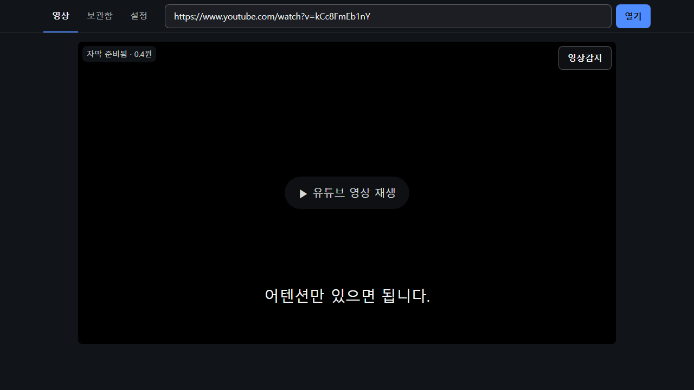
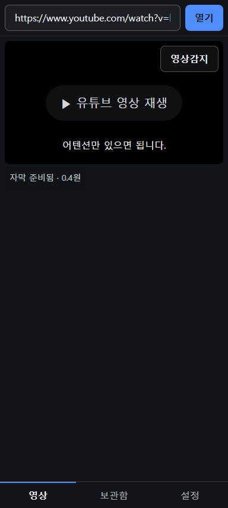
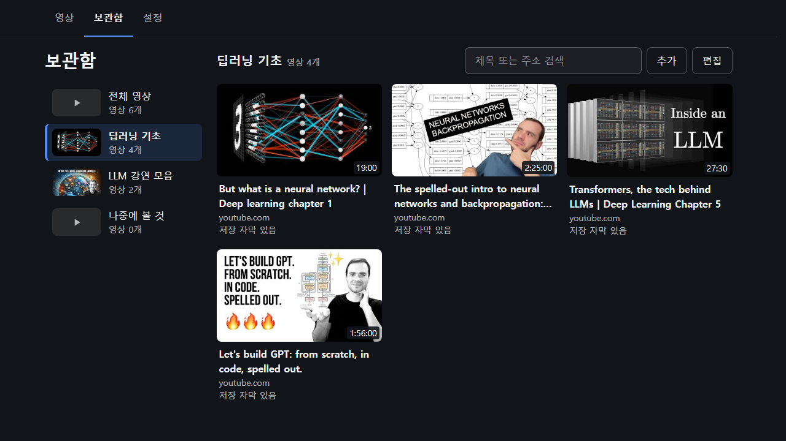
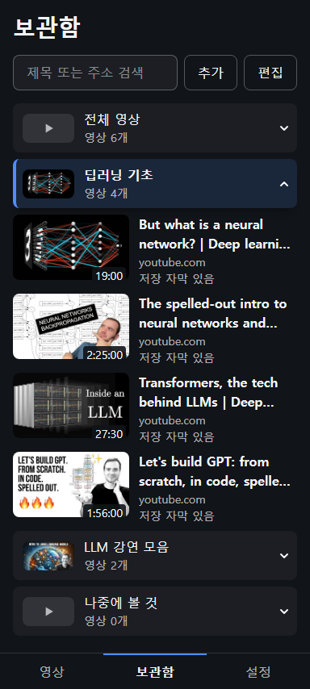
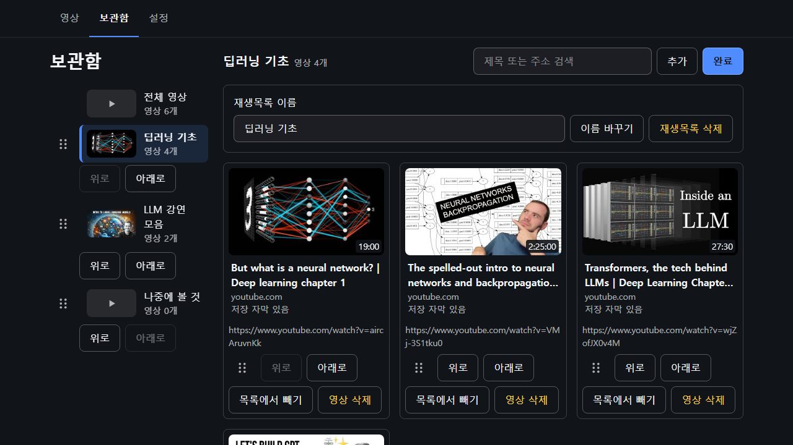
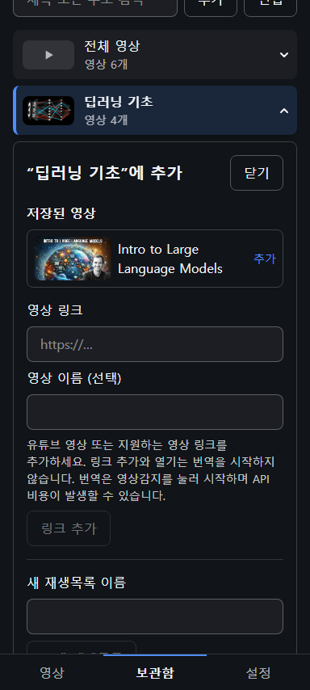
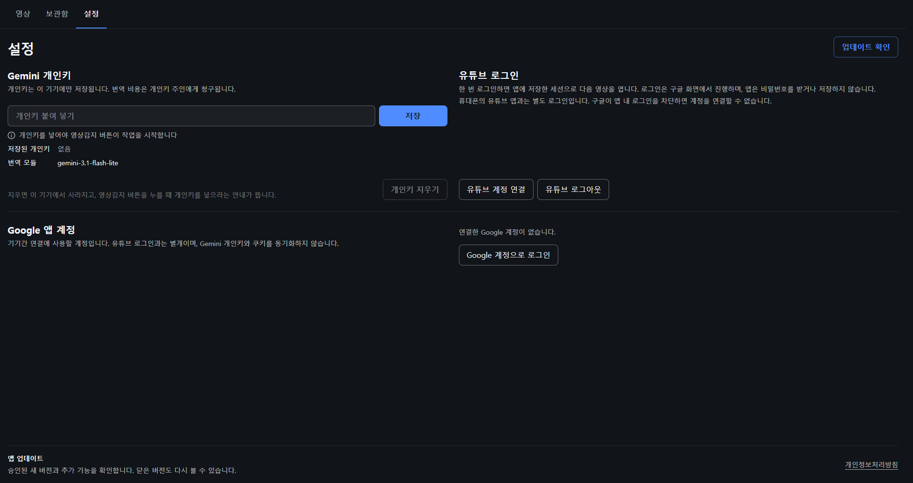
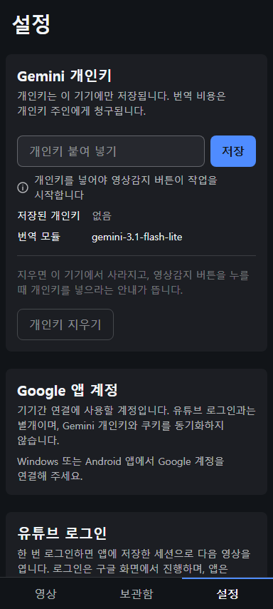

# 화면 설계 — video-translate-overlay-2

> 첫 화면은 번역하고 싶은 영상 위에 뜬 오버레이에서 영상감지 버튼을 눌러 자막 작업을 시작하는 화면입니다.

## 첫 화면 S1 `/`

주소 칸에 주소를 넣어 영상을 열고, 영상 위 오버레이에서 영상감지 버튼을 눌러 자막 작업을 시작한 뒤 진행 상태와 자막을 보는 화면

## Navigation between screens

The three screens share one menu, 영상 (`/`), 보관함 (`/library`) and 설정
(`/preferences`), in the same place on each (`src/ui/Nav.svelte`). From a
768 px window width it is a row of tabs at the left of the top bar; the current
tab is semibold with a blue underline on the bar's edge. Below 768 px it is a
bottom tab bar of three 44 px targets that pads itself by the safe-area inset,
with a blue top bar on the current tab. The current tab carries
`aria-current="page"`. The address field sits in the top bar on `/` only. The
library no longer has its own 영상 열기 link and settings no longer has
← 영상으로; on `/`, 영상 열기 still names the button in a ready notice.

### Maximized desktop layout

The desktop menu and all three pages start at the same 16 px inset. The page
containers no longer have separate centered maximum widths. The library keeps
the established rail, grid and phone accordion; extra desktop width adds grid
columns. The video stage keeps its 16:9 ratio and fits the height below its actual
position, including address errors and ready notices above it. Desktop fitting rechecks after content and window
resizes; the narrow-screen layout remains unchanged.

### Automatic subtitle sizing

The injected site overlay and the local screen overlay size subtitles from the
visible video image, excluding letterboxing and the portion outside the viewport.
The reading size is 3% of that width, limited to 5.5% of its height, with a 14 px
minimum. A 1920×1080 image therefore uses 57.6 px text instead of the former
26 px injected ceiling. Restoring or resizing the player recalculates the size.
Korean words wrap, explicit newlines remain, and the bottom clearance scales
with image height to leave player controls accessible. Cue selection still uses
the player's source clock; sizing never edits subtitles or their timestamps.

Settings is reconstructed at 1920×1080 with no overall width cap. Gemini setup
and YouTube session controls occupy an equal-height grid row from 1024 px;
their bottom actions align through flex layout, without fixed blank spacers.
The key form and removal group can grow to 60 rem. Google app-account sync is
the next full-width row. Update checking is a prominent 44 px control at the
header's trailing edge, aligned with the page's right inset. Privacy remains
in the secondary footer and stays available before sign-in with the same fixed
native opener and retryable error. Below 1024 px the tasks stack, preserving
their controls and confirmations. The palette and shared navigation are
unchanged. Earlier card, flat-row and capped hierarchy revisions were rejected;
their captures are historical, not accepted final designs.

## 기능을 둔 자리

| 기능 | 주인이 고른 칸 | 놓인 화면 |
| --- | --- | --- |
| 주소 넣어 영상 사이트 열기 (`open-site`) | 늘 쓴다 | S1 |
| 영상감지 버튼 누르기 (`detect-video`) | 늘 쓴다 | S1 |
| 진행 상태와 비용 보기 (`job-progress`) | 늘 쓴다 | S1 |
| 자막 보기 (`watch-subtitles`) | 늘 쓴다 | S1 |
| 개인키 넣기 (`set-api-key`) | 가끔 쓴다 | S2 |
| 개인키 지우기 (`delete-api-key`) | 드물게 쓴다 | S2 |
| 유튜브 로그아웃 (`youtube-logout`) | 드물게 쓴다 | S2 |

## 다른 화면

### S3 `/library` — find saved translations and manually select topic videos

People come here to reopen a translated lecture or to go through a topic
playlist; activating a playlist shows its videos at once. The screen uses the
approved C1 palette and existing type/spacing tokens in `DESIGN.md`.

| Window | Layout |
| --- | --- |
| 768 px and wider | A 16 rem rail of 전체 영상 and every playlist (cover, name, count; the selected one tinted with a blue edge and `aria-current`) beside a pane with the selected list's heading, the toolbar and a grid of video cards |
| Below 768 px | One column: heading, toolbar, then one row per list; tapping a row expands its cards directly under it (`aria-expanded`) and closes any other; the open row is pinned to the top while its cards scroll |

A card is the button that opens its video through P1, as the old 영상 열기
button did: a 16:9 thumbnail (YouTube's image for a YouTube video ID; for other
sites or a failed load, a tile with the host and a play mark), the duration when
known, a two-line title, the site name and the status. A playlist's cover is its
first video's thumbnail.

The toolbar holds only the search, 추가 and 편집. Edit mode (편집, then 완료)
lists the videos in one column, thumbnail beside title, because a grid card is
too narrow for its controls. It shows the full address on each entry, the
saved-version selector, a drag handle
and labeled 위로 / 아래로 on playlists and entries, the selected playlist's
rename field and 재생목록 삭제, and 목록에서 빼기 and 영상 삭제 on cards. A drop
sends one P11 move of any number of places; the buttons are the keyboard path.
The add panel holds a saved-video picker with thumbnails, the link field with an
optional name and the cost note, and + 새 재생목록, which selects the new list.

Loading has a status announcement; failed reads show the error and a retry;
an empty library explains translation and playlist links; empty playlists and
empty searches give distinct guidance. Errors never masquerade as an empty list.
A refresh after a change keeps the shown library and scroll position until it
answers; the loading state appears only before the first answer and after an
account change.
Permanent video deletion uses a focused inline confirmation naming the video,
the data removed, and possible future API costs. Playlist deletion explains that
saved translations remain. Processing videos disable deletion; failed file
cleanup keeps a retryable row and hides subtitles.

#### Design pass, 2026-11-17

The five steps of the `design-pass` skill, in order, on the stand-in server
(`node scripts/live.mjs --stand-ins`) seeded with five YouTube lectures, one
link from another site and three playlists (one empty).

0. Purpose. Who: a person returning to translated lectures. To do: find one, or
   go through a topic playlist. Success: the chosen video opens on the watch
   screen with its saved subtitles. This rules out a playlist page and keeps
   management off the default view.
1. `DESIGN.md` and the sketch. Components and the 768 px split are recorded
   there; C1 and the 14/16/20/28 px scale are unchanged.
2. Measurement in Chromium, after the last layout change (values in px). Headless
   Chromium draws classic scrollbars, so from 768 px the reserved 15 px gutter
   narrows the page; the phone layout reserves none:

   | Viewport | Main padding | Menu | Heading | First list item | Toolbar | First card | Card / thumbnail | Overflow |
   | --- | --- | --- | --- | --- | --- | --- | --- | --- |
   | 1280×720 | 16 | x 73, y 0, h 60 | x 73, y 81, 28 | x 73, y 137, 256 × 61, pad 8 | x 353, y 77, h 44 (search 288, 추가 66, 편집 66) | x 353, y 137 | 269 × 254 / 269 × 151 | none (1,265 of 1,265) |
   | 1009×720 | 16 | x 16, y 0, h 60 | x 16, y 81, 28 | x 16, y 137, 256 × 61, pad 8 | x 296, y 77, h 80 (heading on its own line below 1024) | x 296, y 173 | 217 × 224 / 217 × 122 | none (994 of 994) |
   | 384×854 | 16 | bottom, y 809, h 45 (44 + border) | x 16, y 16, 28 | x 16, y 128, 352 × 61, pad 8 | x 16, y 68, h 44 (search 204, 추가 66, 편집 66) | x 16, y 266 | 352 × 90 / 144 × 81 | none (384 of 384) |

   Before the change the first card of a selected playlist was at y 1,237
   (1280×720) and y 1,483 (384×854). One finding was fixed: the first rail item
   sat 8 px above the first card (129 against 137), so the rail heading block
   now takes the toolbar's 44 px height. The same-role check reported only
   text-driven widths (tab labels, duration badges, the chevron's path). 편집,
   완료, 추가 and 닫기 each toggled the expected state when pressed; delete and
   confirmation buttons were checked by reading their handlers and through
   `tests/ui/library.test.ts`.

   The same states were then captured in the Windows debug app (a 1,024 × 760
   viewport; first card at x 296, y 137, no overflow) and the Android API 34
   emulator (412 × 842; first card at y 266, no overflow). Two findings were
   fixed. In the Windows window a grid card is about 210 px wide, so in edit
   mode its address broke mid-word and its buttons wrapped onto four lines;
   edit mode is now a one-column list, and from 768 px the page reserves the
   scrollbar's gutter so the toolbar no longer shifts 15 px when the longer
   edit view starts to scroll. The Android WebView (Chrome 113) drew Tailwind's default
   placeholder colour, a `currentcolor` mix, as transparent, which left the
   search field blank; the library's inputs now set the same placeholder
   colour as the address and key fields. The before and after captures from
   all three are in `docs/evidence/library-rail/`.
3. Type. Four levels with one meaning each: 28 the page heading, 20 the pane and
   panel headings, 16 controls and names (semibold for card titles and the
   selected list), 14 site, count, status and duration.
4. Colour. The person kept C1 when it was offered for this change; selection uses
   the primary blue at 15 % and a 4 px edge, hover uses the ink at 5 %.
5. Leftover space. A short playlist leaves the grid's lower area empty on wide
   windows. There is no value worth placing there, so it stays empty.

Requests use screen generations to drop late results after navigation or refresh.
Native deletion invalidates open views; browser tabs use BroadcastChannel. Saved
playback views also poll availability and clear stale cues on deletion. Source
links open through P1, so selecting an untranslated entry never starts P6.

The native site overlay reads saved playback position once per mounted player
and may seek once after metadata is ready and an advertisement ends. User input
or an earlier seek cancels a delayed resume. It saves actual position through
existing P7 modes and never applies later remote position updates to playback
already controlled on this device. It does not start, pause or change speed.

Videos with multiple retained completed responses count them on the card and
show a native saved-version select control in edit mode. It names the current
response and orders recent selection or completion first. Selection is disabled during processing/deletion; the user
reopens the video to use that response. It does not start a paid translation.

### S2 `/preferences` — 개인키를 넣거나 지우고 유튜브 로그아웃을 하는 설정 화면

The development build's Google app account section is separate from Gemini
credentials and YouTube sign-in. It shows account identity and native connection
recovery, confirms sign-out, and preserves local libraries. A 44 px privacy
control in the secondary footer is available before sign-in: native P18 opens only the published policy
in the external browser, while HTTP screens use a normal HTTPS link. Opening it
does not change the selected account or last-opened video. Failures remain
retryable without exposing platform diagnostics.

The user accepted the 1920×1080 reconstruction on 2026-11-17. Its rendered
evidence and focused checks are recorded in
`docs/evidence/maximized-layout/README.md`.

## 색 배합 (하나를 고른다)

| id | 이름 | primary | surface | text | accent |
| --- | --- | --- | --- | --- | --- |
| C1 (고름) | 먹색 극장 | `#4f8cff` | `#111418` | `#f2f4f7` | `#ffd24a` |
| C2 | 종이와 잉크 | `#1f5fbf` | `#ffffff` | `#1b1f24` | `#c2410c` |
| C3 | 숲속 칠판 | `#2f9e6e` | `#0f1a17` | `#e9f2ee` | `#f2c14e` |

화면마다의 상태, 백엔드 리뷰

- **S1.states** 비었을 때: 아직 연 영상이 없으면 주소 칸과 "영상 주소를 넣으면 여기에서 열립니다"라는 안내만 보인다. 영상을 열었는데 자막이 없으면 오버레이에 영상감지 버튼만 떠 있다. / 불러오는 중: 영상감지 버튼을 누르면 오버레이에 진행 상태가 뜬다. 내려받는 중, write 중, 번역 중 가운데 지금 단계와 퍼센트, 지금까지 든 비용이 1초마다 새로 보이고 자막은 아직 뜨지 않는다. / 오류: 개인키가 없으면 개인키를 넣으라는 안내와 설정으로 가는 버튼이, 내려받을 수 없는 영상이면 그 까닭이, 다른 영상의 작업이 돌고 있으면 그 작업이 끝난 뒤 다시 누르라는 안내가 오버레이에 뜬다. 작업이 도중에 멈추면 까닭(말소리 없음, 개인키 거절, 비용 한도, 번역 실패)과 영상감지 버튼이 다시 보인다. 열 수 없는 주소는 주소 칸 아래에 알린다. / 찼을 때: 자막이 준비된 영상을 틀면 영상 아래쪽에 한국어 자막이 재생 위치에 맞춰 뜨고, 오버레이 구석에 "자막 준비됨"과 든 비용이 작게 남는다. 광고가 나오는 동안에는 자막이 숨었다가 본편이 이어지면 다시 뜬다.
- **S2.states** 비었을 때: 개인키를 넣지 않았으면 개인키 칸이 비어 있고 "개인키를 넣어야 영상감지 버튼이 작업을 시작합니다"라는 안내가 보인다. 개인키 지우기 버튼은 흐리게 꺼져 있다. / 불러오는 중: 저장을 누르면 Gemini에 개인키를 확인하는 동안 저장 버튼이 "확인하는 중"으로 바뀌고 다시 눌리지 않는다. / 오류: Gemini가 개인키를 받아 주지 않으면 칸 아래에 "쓸 수 없는 개인키입니다"가, 확인할 곳에 닿지 않으면 "지금은 확인할 수 없습니다. 잠시 뒤에 다시 눌러 주세요"가 뜨고 넣은 값은 그대로 남는다. / 찼을 때: 개인키가 끝 네 글자만 남기고 가려져 보이고, 번역 모듈 이름과 개인키 지우기 버튼, 유튜브 로그아웃 버튼이 보인다. 지우기와 로그아웃은 누르면 한 번 더 묻는다.

- 백엔드 리뷰: approve (`68dc268e4d50`), 발견 0개

