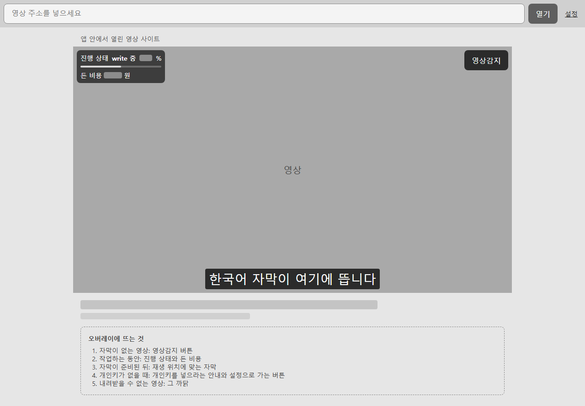
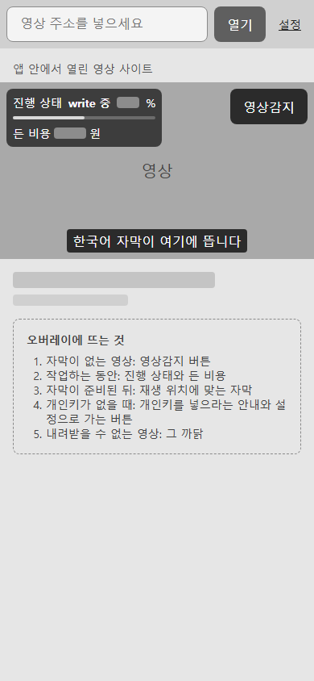
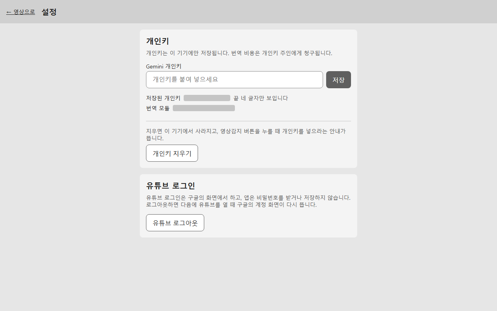
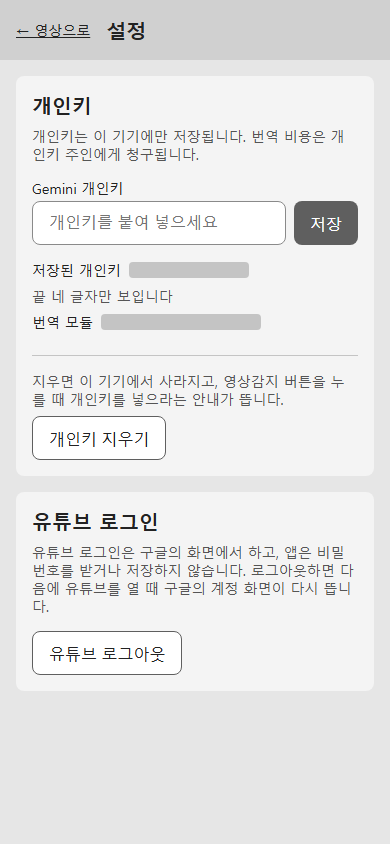

# 화면 설계 — video-translate-overlay-2

> 첫 화면은 번역하고 싶은 영상 위에 뜬 오버레이에서 영상감지 버튼을 눌러 자막 작업을 시작하는 화면입니다.

## 첫 화면 S1 `/`

주소 칸에 주소를 넣어 영상을 열고, 영상 위 오버레이에서 영상감지 버튼을 눌러 자막 작업을 시작한 뒤 진행 상태와 자막을 보는 화면

## 기능을 둔 자리

| 기능 | 주인이 고른 칸 | 놓인 화면 |
| --- | --- | --- |
| 주소 넣어 영상 사이트 열기 (`open-site`) | 늘 쓴다 | S1 |
| 영상감지 버튼 누르기 (`detect-video`) | 늘 쓴다 | S1 |
| 진행 상태와 비용 보기 (`job-progress`) | 늘 쓴다 | S1 |
| 자막 보기 (`watch-subtitles`) | 늘 쓴다 | S1 |
| 개인키 넣기 (`set-api-key`) | 가끔 쓴다 | S2 |
| 개인키 지우기 (`delete-api-key`) | 드물게 쓴다 | S2 |
| 유튜브 로그아웃 (`youtube-logout`) | 드물게 쓴다 | S2 |

## 다른 화면

### S3 `/library` — find saved translations and manually select topic videos

The address bar links to `보관함`. The screen uses the approved C1 palette and
existing type/spacing tokens in `DESIGN.md`. It has a title/source search, saved
subtitle availability, ordered topic playlists, and explicit open/delete actions.
Playlist selection reveals rename/delete, saved-video selection, and link entry.
Arrow buttons reorder playlists and entries without requiring drag gestures.

Loading has a status announcement; failed reads show the error and a retry;
an empty library explains translation and playlist links; empty playlists and
empty searches give distinct guidance. Errors never masquerade as an empty list.
Permanent video deletion uses a focused inline confirmation naming the video,
the data removed, and possible future API costs. Playlist deletion explains that
saved translations remain. Processing videos disable deletion; failed file
cleanup keeps a retryable row and hides subtitles.

Requests use screen generations to drop late results after navigation or refresh.
Native deletion invalidates open views; browser tabs use BroadcastChannel. Saved
playback views also poll availability and clear stale cues on deletion. Source
links open through P1, so selecting an untranslated entry never starts P6.

### S2 `/preferences` — 개인키를 넣거나 지우고 유튜브 로그아웃을 하는 설정 화면

## 색 배합 (하나를 고른다)

| id | 이름 | primary | surface | text | accent |
| --- | --- | --- | --- | --- | --- |
| C1 (고름) | 먹색 극장 | `#4f8cff` | `#111418` | `#f2f4f7` | `#ffd24a` |
| C2 | 종이와 잉크 | `#1f5fbf` | `#ffffff` | `#1b1f24` | `#c2410c` |
| C3 | 숲속 칠판 | `#2f9e6e` | `#0f1a17` | `#e9f2ee` | `#f2c14e` |

화면마다의 상태, 백엔드 리뷰

- **S1.states** 비었을 때: 아직 연 영상이 없으면 주소 칸과 "영상 주소를 넣으면 여기에서 열립니다"라는 안내만 보인다. 영상을 열었는데 자막이 없으면 오버레이에 영상감지 버튼만 떠 있다. / 불러오는 중: 영상감지 버튼을 누르면 오버레이에 진행 상태가 뜬다. 내려받는 중, write 중, 번역 중 가운데 지금 단계와 퍼센트, 지금까지 든 비용이 1초마다 새로 보이고 자막은 아직 뜨지 않는다. / 오류: 개인키가 없으면 개인키를 넣으라는 안내와 설정으로 가는 버튼이, 내려받을 수 없는 영상이면 그 까닭이, 다른 영상의 작업이 돌고 있으면 그 작업이 끝난 뒤 다시 누르라는 안내가 오버레이에 뜬다. 작업이 도중에 멈추면 까닭(말소리 없음, 개인키 거절, 비용 한도, 번역 실패)과 영상감지 버튼이 다시 보인다. 열 수 없는 주소는 주소 칸 아래에 알린다. / 찼을 때: 자막이 준비된 영상을 틀면 영상 아래쪽에 한국어 자막이 재생 위치에 맞춰 뜨고, 오버레이 구석에 "자막 준비됨"과 든 비용이 작게 남는다. 광고가 나오는 동안에는 자막이 숨었다가 본편이 이어지면 다시 뜬다.
- **S2.states** 비었을 때: 개인키를 넣지 않았으면 개인키 칸이 비어 있고 "개인키를 넣어야 영상감지 버튼이 작업을 시작합니다"라는 안내가 보인다. 개인키 지우기 버튼은 흐리게 꺼져 있다. / 불러오는 중: 저장을 누르면 Gemini에 개인키를 확인하는 동안 저장 버튼이 "확인하는 중"으로 바뀌고 다시 눌리지 않는다. / 오류: Gemini가 개인키를 받아 주지 않으면 칸 아래에 "쓸 수 없는 개인키입니다"가, 확인할 곳에 닿지 않으면 "지금은 확인할 수 없습니다. 잠시 뒤에 다시 눌러 주세요"가 뜨고 넣은 값은 그대로 남는다. / 찼을 때: 개인키가 끝 네 글자만 남기고 가려져 보이고, 번역 모듈 이름과 개인키 지우기 버튼, 유튜브 로그아웃 버튼이 보인다. 지우기와 로그아웃은 누르면 한 번 더 묻는다.

- 백엔드 리뷰: approve (`68dc268e4d50`), 발견 0개

