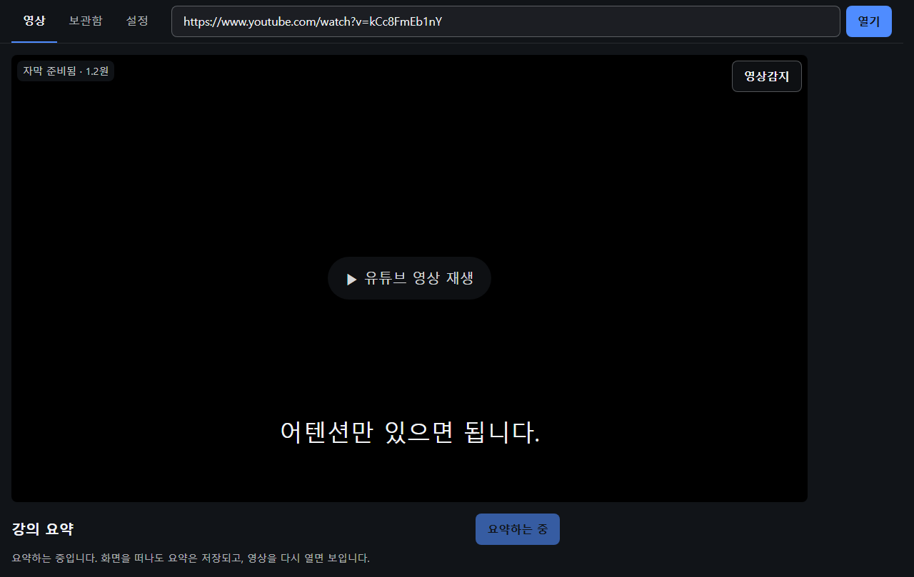
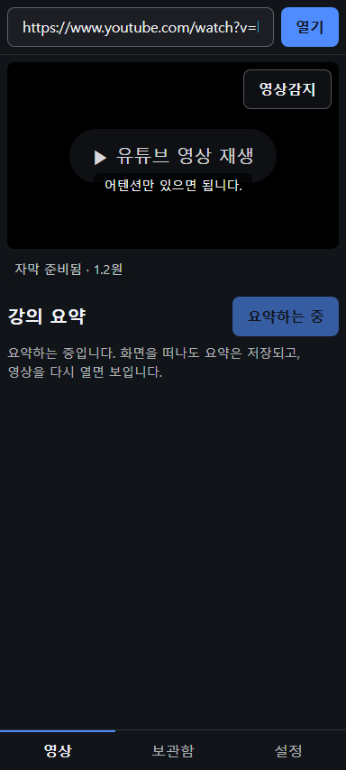
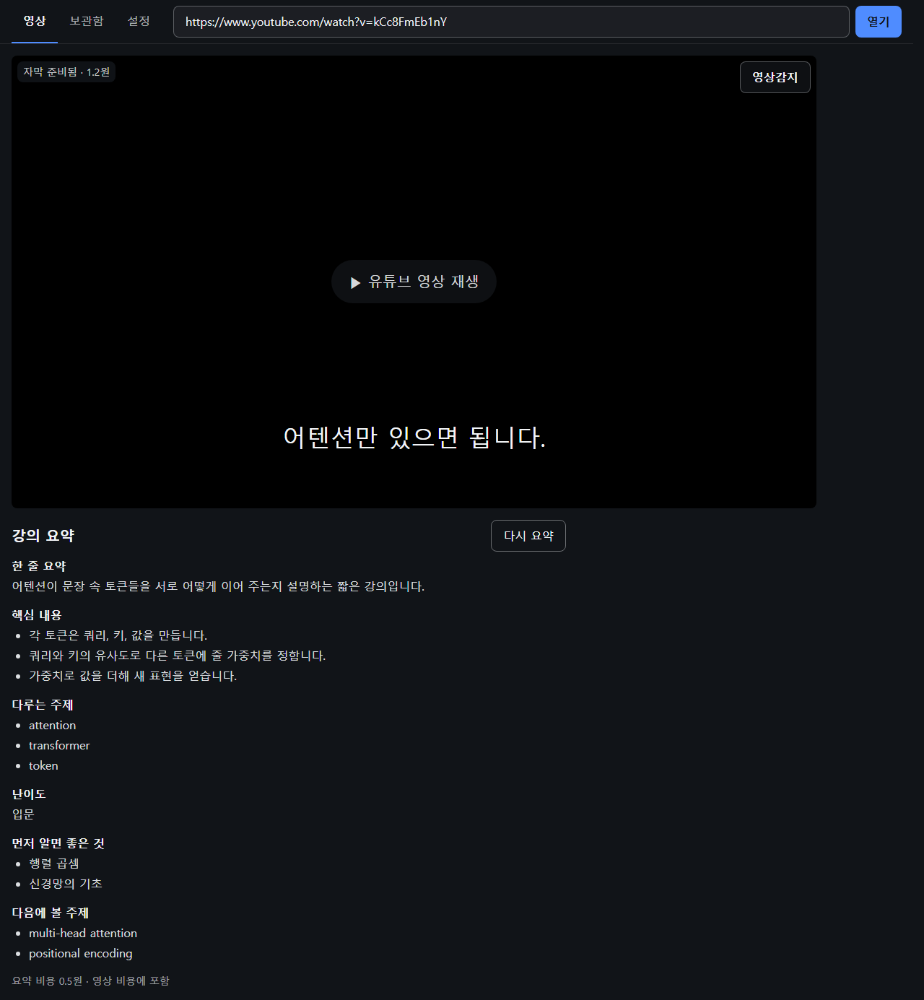
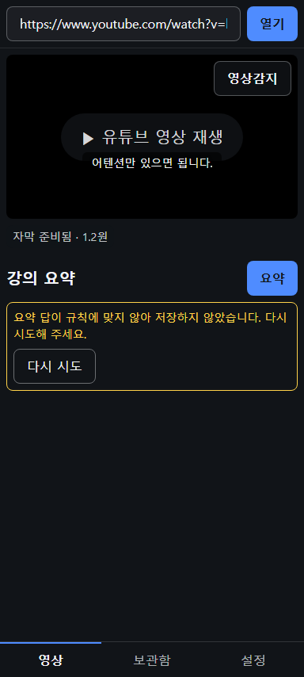

# Video summary (요약): execution evidence

## The paid run

One real summary call, approved by the person on 2026-11-20, with the Gemini
key the installed Windows app had saved in Credential Manager.

- Lecture: `[1hr Talk] Intro to Large Language Models` (`zjkBMFhNj_g`,
  59:48, 1,409 cues, 62,770 characters of source transcript).
- Data: a copy of the account library
  (`%LOCALAPPDATA%/dev.vto.overlay/sync/9d06…/sync.sqlite3` with its WAL) in
  the ignored folder `artifacts/video-summary/paid/app.sqlite3`. The installed
  app's files were only read. The copy was deleted after the run.
- Build: the app library as committed in `7bc20c8` (the next commit adds
  only the tool, the stand-in's summary reply and a heading size), and the
  tool `src-tauri/examples/summarize_saved.rs`, which sends the request through
  `api::library_request(…, "video_summary", …)`, the path the screen's
  `POST /videos/{video_key}/summary` takes.
- Command, 2026-11-20 22:48:53 to 22:48:57 +0900:
  `target/debug/examples/summarize_saved.exe artifacts/video-summary/paid zjkBMFhNj_g`

### Reported usage and computed cost

The app's log line:
`[vto] summary zjkBMFhNj_g: input=16201 output=380 cost_krw=6.6994 ok=true`

| | Tokens | Price (USD per 1M) | KRW at 1,450 per USD |
| --- | --- | --- | --- |
| Input (`promptTokenCount`) | 16,201 | 0.25 | 5.8728625 |
| Output (candidates + thoughts) | 380 | 1.50 | 0.8265 |
| Total | | | **6.6993625** |

The reply's `cost_krw` was `6.6993625`. P7 for the video then reported
`cost_krw=787.7962375`, which is the translation's saved 781.096875 plus the
summary's 6.6993625, and `summary_cost_krw=6.6993625`. The reply passed every
value check (`ok=true`) and was stored.

### The rendered summary

The Markdown the app rendered from the stored JSON, as the reply returned it:

```markdown
## 한 줄 요약

거대 언어 모델의 기본 개념부터 학습 과정, 도구 활용, 그리고 보안 취약점까지 전반적인 내용을 다루는 입문 강의입니다.

## 핵심 내용

- 거대 언어 모델은 방대한 인터넷 데이터를 압축하여 다음 단어를 예측하도록 학습된 신경망입니다.
- 모델 학습은 사전 학습(Pre-training)과 파인 튜닝(Fine-tuning)의 두 단계로 나뉘며, 각각 지식 습득과 어시스턴트 형태의 정렬을 담당합니다.
- 스케일링 법칙에 따라 모델의 파라미터 수와 학습 데이터 양을 늘리면 성능이 예측 가능하게 향상됩니다.
- 최신 모델은 단순한 텍스트 생성을 넘어 도구 사용, 멀티모달리티, 시스템 2 사고를 통해 복잡한 문제를 해결하는 운영체제와 같은 역할을 수행합니다.
- 탈옥(Jailbreak), 프롬프트 인젝션, 데이터 포이즈닝 등 거대 언어 모델만의 새로운 보안 위협과 그에 대한 대응이 중요합니다.

## 다루는 주제

- Large Language Models
- Transformer
- pre-training
- fine-tuning
- RLHF
- scaling laws
- multimodality
- prompt injection

## 난이도

입문

## 먼저 알면 좋은 것

없음

## 다음에 볼 주제

- mechanistic interpretability
- reinforcement learning from human feedback
- retrieval augmented generation
- scaling laws
- adversarial machine learning
```

Gemini accepted the response JSON schema as sent (`responseJsonSchema` with
`enum`, `minItems` and `additionalProperties`): the call returned 200. Prose
fields came back in Korean; topics and next topics stayed in English, the
lecture's language.

## Screen captures

Taken on the stand-in server (`node scripts/live.mjs --stand-ins`, seeded
with `e2e/seed.json`) in headless Chromium by a local Playwright script. The
loading and error states answer P19 through Playwright routing (a reply held
open, and a `502 summary_invalid`); the summary state is the stand-in
Gemini's reply through the real backend. Phone captures are full-page, so
the fixed bottom tab bar appears where the window ended.

| State | 1280×720 | 384×854 |
| --- | --- | --- |
| Button |  |  |
| Loading |  |  |
| Summary |  |  |
| Error |  |  |

The person inspected these on 2026-11-20 and chose the section below the
player, as captured, over a right-hand column on wide windows or a button on
the overlay's status chip. At 1280×720 the player fills the window height, so
the 요약 button is reached with a short scroll.

These captures were taken before review round 1 and committed in `9d02521`. Round 1 changed no layout. The only screen change makes a refused
다시 요약 re-read the stored summary's cost. Each verification run
captures the same four states again and asserts each one in its
`report.json`.

## Where the current record is

A record cannot sit inside the commit it describes, and a record committed
after it describes an older head (`docs/research/review-video-summary-f4-1.md`,
`docs/research/review-video-summary-f4-2.md`). So no execution record is
committed here. Each review round's record is made at that round's final
pushed head, with no commit after it, by the steps below:

1. Start the stand-in server from an empty data folder:
   `PORT=8793 APP_DATA_DIR=<empty dir> node scripts/live.mjs --stand-ins`.
2. Run `node scripts/verification/video-summary.mjs http://127.0.0.1:8793 <out>`.
   It seeds `e2e/seed.json`, waits until the seeded video is ready, and
   writes `<out>/report.json`, which holds the head `GET /build` named, the
   checkout's head and anything it has not committed, the commit `dist/`
   was built at, the environment and each check's expected and observed
   values. Every page the browser checks use (button and loading, error,
   stored summary, leave and reopen) records each document it loads: the
   served HTML must carry the server's head in its `wiki-build-head` meta,
   and that document and every script and style it is served must be
   `dist/` byte for byte. All those reads finish before a page closes and
   before the checks are recorded. At each window size the run presses 다시 요약,
   leaves the screen while the stand-in Gemini (3 s per summary) holds the
   call, opens the video again, and checks that the first read says
   `pending`, the screen waits, the stored summary then appears with no
   POST of its own, and the call was metered once. The stand-in numbers each
   summary's gist (`N번째 요약: …`), so the run also checks that the gist
   shown after reopening is the one the call stored and differs from the
   gist shown before 다시 요약 was pressed.

The focused offline checks are these commands, each quoted in the report
exactly as it was run, each with its own output. With `VTO_CONTRACT_HOST` set
to the built `target/debug/vto-contract-host.exe`, from the repository root:

```sh
cargo test --manifest-path contract-tests/Cargo.toml --test summary -- --nocapture --test-threads=1
cargo test --manifest-path contract-tests/Cargo.toml --test translation -- --nocapture --test-threads=1
cargo test --manifest-path contract-tests/Cargo.toml --test harness -- --nocapture
```

Each contract run prints a `contract host launched: … head=… pid=…` line
for every host it starts, and the harness run also prints the folder it
kept and its host's log. In `src-tauri`, with one filter per command, since
cargo takes only one filter before `--`:

```sh
cargo test --lib summary::
cargo test --lib commands::tests::the_api_document_names_each_operation_once_and_declares_its_path_parameters
cargo test --lib store::library_tests::a_summary_counts_only_for_the_video_row_it_was_made_for
cargo test --bin vto-web
```

Then `npx vitest run -c vitest.ui.config.ts tests/ui/summary.test.ts tests/ui/watch.test.ts tests/ui/subtitles.test.svelte.ts tests/ui/library-layout.test.ts`.

The generated `report.json` and the focused commands' raw output go into that
round's report, in full. A round that reuses an earlier run made at the same
head carries that run's `report.json` again, in full, never a digest or a
pointer to an earlier round's report: the reviewer reads only the current
round's packet. The report is the current record; this folder keeps only the
paid run and the captures the person inspected.

## Round 1's record at `70f30c8` (history)

Round 1 ran the same steps at `70f30c8`
(`GET /build` head `70f30c897b87e3e8ce16be42e4577ab9ea93290a`, pid 35636),
on Windows 11 Home 10.0.26200, Node v24.18.0, Playwright 1.61.0 (headless
Chromium) and rustc 1.98.1, at 2026-11-20 23:43 +0900. 21/21 checks passed.
Its `report.json` was committed here until round 5, which removed it because
it named a head older than the one under review. The code has changed since
then, so the table below records history, not the current head.

| Where | Check | Observed |
| --- | --- | --- |
| API | `GET` before any summary | 404 `no_summary` |
| API | `GET` for an unknown video | 404 `no_video` |
| API | `POST` with a site `Origin` (`https://www.youtube.com`) | 403 |
| API | `POST {}` | 200, `reused:false`, Markdown with the six template sections |
| API | P7 after it | `cost_krw` 1.1987875 = translation 0.6564875 + summary 0.5423; `summary_cost_krw` 0.5423 |
| API | `POST {}` again | 200, `reused:true`, same Markdown, cost unchanged (no call) |
| API | `GET` | 200, `reused:true`, same Markdown |
| API | `POST {"again":true}` | 200, `reused:false`, summary cost 1.0846 (two calls) |
| API | P7 after it | `cost_krw` 1.7410875 |
| 1280×720 and 384×854 | Button | the section sits below the player frame and every visible status chip |
| 1280×720 and 384×854 | Loading | 요약하는 중 disabled, section `aria-busy="true"` |
| 1280×720 and 384×854 | Error (`502 summary_invalid` routed in the page) | the alert holds the message and 다시 시도 |
| 1280×720 and 384×854 | Summary (through the backend) | six headings, the 요약 비용 line, and no `POST` on opening |

The loading and error states answer P19 in the page by Playwright routing.
Every other step goes through the real server and the stand-in Gemini.

### Offline checks at the same head

| Command | Result |
| --- | --- |
| `cargo test --lib -- summary:: commands:: store:: api:: account web` (in `src-tauri`) | 54 passed |
| `cargo test -p vto-contract-tests --test summary` (with `VTO_CONTRACT_HOST` set to the built host) | 3 passed |
| `cargo test -p vto-contract-tests --test translation` (T9, T10 among them) | 5 passed |
| `npx vitest run -c vitest.ui.config.ts tests/ui/summary.test.ts tests/ui/watch.test.ts` | 29 passed |
| `npm run build` | built |

The 54 library tests include these round-1 tests:

- `summary::flow_tests::a_summary_is_stored_only_into_the_entry_it_was_read_from`
- `summary::flow_tests::signing_out_during_the_call_keeps_the_reply_and_its_usage_in_the_account_that_paid`
- `summary::tests::each_field_is_held_to_its_language`
- `commands::tests::the_api_document_names_each_operation_once_and_declares_its_path_parameters`

## Reused results

The paid run above is reused in every round, not repeated. It ran at `7bc20c8`, before
round 1 changed two things:

- The system prompt now asks for each prerequisite as a Korean phrase and for
  no Korean in topics of a non-Korean talk. This adds a few dozen input
  tokens.
- The value check is stricter.

Its reply still passes the stricter check: no prerequisites, and topics and
next topics with no Hangul for an English lecture. A new paid call needs the
person's approval and was not made.
