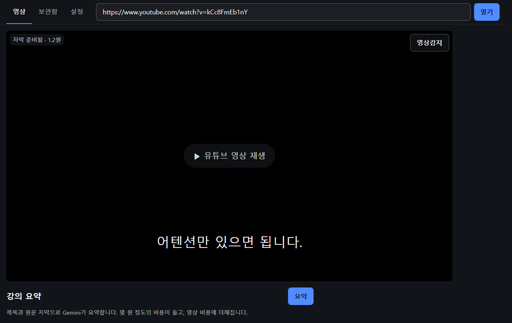
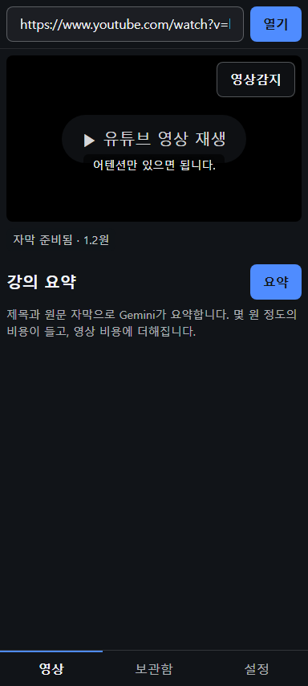
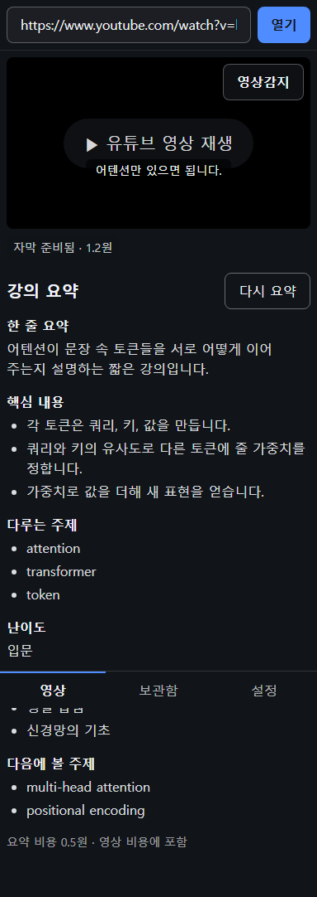
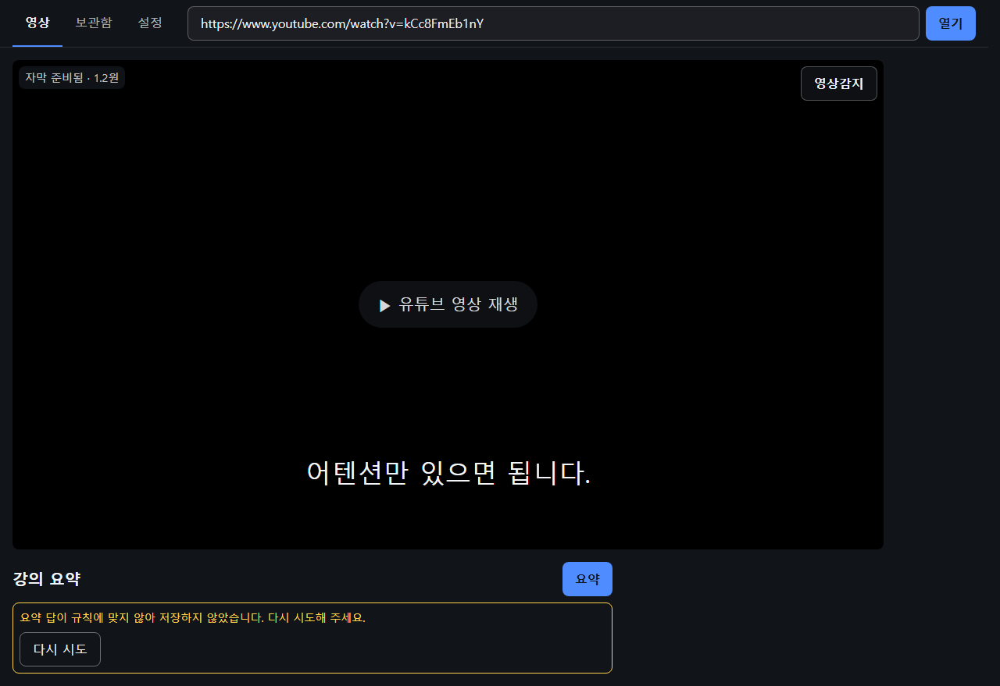

# Video summary (요약): execution evidence

## The paid run

One real summary call, approved by the person on 2026-11-20, with the Gemini
key the installed Windows app had saved in Credential Manager.

- Lecture: `[1hr Talk] Intro to Large Language Models` (`zjkBMFhNj_g`,
  59:48, 1,409 cues, 62,770 characters of source transcript).
- Data: a copy of the account library
  (`%LOCALAPPDATA%/dev.vto.overlay/sync/9d06…/sync.sqlite3` with its WAL) in
  the ignored folder `artifacts/video-summary/paid/app.sqlite3`. The installed
  app's files were only read. The copy was deleted after the run.
- Build: the app library as committed in `7bc20c8` (the next commit adds
  only the tool, the stand-in's summary reply and a heading size), and the
  tool `src-tauri/examples/summarize_saved.rs`, which sends the request through
  `api::library_request(…, "video_summary", …)`, the path the screen's
  `POST /videos/{video_key}/summary` takes.
- Command, 2026-11-20 22:48:53 to 22:48:57 +0900:
  `target/debug/examples/summarize_saved.exe artifacts/video-summary/paid zjkBMFhNj_g`

### Reported usage and computed cost

The app's log line:
`[vto] summary zjkBMFhNj_g: input=16201 output=380 cost_krw=6.6994 ok=true`

| | Tokens | Price (USD per 1M) | KRW at 1,450 per USD |
| --- | --- | --- | --- |
| Input (`promptTokenCount`) | 16,201 | 0.25 | 5.8728625 |
| Output (candidates + thoughts) | 380 | 1.50 | 0.8265 |
| Total | | | **6.6993625** |

The reply's `cost_krw` was `6.6993625`. P7 for the video then reported
`cost_krw=787.7962375`, which is the translation's saved 781.096875 plus the
summary's 6.6993625, and `summary_cost_krw=6.6993625`. The reply passed every
value check (`ok=true`) and was stored.

### The rendered summary

The Markdown the app rendered from the stored JSON, as the reply returned it:

```markdown
## 한 줄 요약

거대 언어 모델의 기본 개념부터 학습 과정, 도구 활용, 그리고 보안 취약점까지 전반적인 내용을 다루는 입문 강의입니다.

## 핵심 내용

- 거대 언어 모델은 방대한 인터넷 데이터를 압축하여 다음 단어를 예측하도록 학습된 신경망입니다.
- 모델 학습은 사전 학습(Pre-training)과 파인 튜닝(Fine-tuning)의 두 단계로 나뉘며, 각각 지식 습득과 어시스턴트 형태의 정렬을 담당합니다.
- 스케일링 법칙에 따라 모델의 파라미터 수와 학습 데이터 양을 늘리면 성능이 예측 가능하게 향상됩니다.
- 최신 모델은 단순한 텍스트 생성을 넘어 도구 사용, 멀티모달리티, 시스템 2 사고를 통해 복잡한 문제를 해결하는 운영체제와 같은 역할을 수행합니다.
- 탈옥(Jailbreak), 프롬프트 인젝션, 데이터 포이즈닝 등 거대 언어 모델만의 새로운 보안 위협과 그에 대한 대응이 중요합니다.

## 다루는 주제

- Large Language Models
- Transformer
- pre-training
- fine-tuning
- RLHF
- scaling laws
- multimodality
- prompt injection

## 난이도

입문

## 먼저 알면 좋은 것

없음

## 다음에 볼 주제

- mechanistic interpretability
- reinforcement learning from human feedback
- retrieval augmented generation
- scaling laws
- adversarial machine learning
```

Gemini accepted the response JSON schema as sent (`responseJsonSchema` with
`enum`, `minItems` and `additionalProperties`): the call returned 200. Prose
fields came back in Korean; topics and next topics stayed in English, the
lecture's language.

## Screen captures

Taken on the stand-in server (`node scripts/live.mjs --stand-ins`, seeded
with `e2e/seed.json`) in headless Chromium by a local Playwright script. The
loading and error states answer P19 through Playwright routing (a reply held
open, and a `502 summary_invalid`); the summary state is the stand-in
Gemini's reply through the real backend. Phone captures are full-page, so
the fixed bottom tab bar appears where the window ended.

| State | 1280×720 | 384×854 |
| --- | --- | --- |
| Button |  |  |
| Loading |  |  |
| Summary |  |  |
| Error |  |  |

The person inspected these on 2026-11-20 and chose the section below the
player, as captured, over a right-hand column on wide windows or a button on
the overlay's status chip. At 1280×720 the player fills the window height, so
the 요약 button is reached with a short scroll.

These captures were taken before review round 1 and committed in `9d02521`. Round 1 changed no layout. The only screen change makes a refused
다시 요약 re-read the stored summary's cost. The same four states were
captured again at the head below, and the run asserts each one in
`report.json`.

## Execution record at `70f30c8` (review round 1)

This section and [`report.json`](report.json) are round 1's record, made at
`70f30c8`. A record cannot sit inside the commit it describes. So a later
record is made with the same script and commands at a pushed head, then
committed under `receipts/<head>/` in a commit that changes only evidence
files: [`receipts/ee936b1`](receipts/ee936b1/README.md) holds the record of
`ee936b1056e24542a85b3b48b698067eb2cb83db` (its `report.json`, the focused
command output, and the id of every path outside
`docs/evidence/video-summary/` at the tested head, which a later head must
match to run, build and test what was tested there).

Environment: Windows 11 Home 10.0.26200, Node v24.18.0, Playwright 1.61.0
(headless Chromium), rustc 1.98.1. Taken 2026-11-20 23:43 +0900.

### API and browser: `report.json`

The steps were:

1. Started the stand-in server from an empty data folder:
   `PORT=8793 APP_DATA_DIR=<empty dir> node scripts/live.mjs --stand-ins`.
2. Ran `node scripts/verification/video-summary.mjs http://127.0.0.1:8793 <out>`.

The server's `GET /build` answered head
`70f30c897b87e3e8ce16be42e4577ab9ea93290a` (pid 35636). The script seeds
`e2e/seed.json`, waits until the seeded video is ready, then records each
check as expected vs observed in [`report.json`](report.json). Result:
21/21 checks passed.

| Where | Check | Observed |
| --- | --- | --- |
| API | `GET` before any summary | 404 `no_summary` |
| API | `GET` for an unknown video | 404 `no_video` |
| API | `POST` with a site `Origin` (`https://www.youtube.com`) | 403 |
| API | `POST {}` | 200, `reused:false`, Markdown with the six template sections |
| API | P7 after it | `cost_krw` 1.1987875 = translation 0.6564875 + summary 0.5423; `summary_cost_krw` 0.5423 |
| API | `POST {}` again | 200, `reused:true`, same Markdown, cost unchanged (no call) |
| API | `GET` | 200, `reused:true`, same Markdown |
| API | `POST {"again":true}` | 200, `reused:false`, summary cost 1.0846 (two calls) |
| API | P7 after it | `cost_krw` 1.7410875 |
| 1280×720 and 384×854 | Button | the section sits below the player frame and every visible status chip |
| 1280×720 and 384×854 | Loading | 요약하는 중 disabled, section `aria-busy="true"` |
| 1280×720 and 384×854 | Error (`502 summary_invalid` routed in the page) | the alert holds the message and 다시 시도 |
| 1280×720 and 384×854 | Summary (through the backend) | six headings, the 요약 비용 line, and no `POST` on opening |

The loading and error states answer P19 in the page by Playwright routing.
Every other step goes through the real server and the stand-in Gemini.

### Offline checks at the same head

| Command | Result |
| --- | --- |
| `cargo test --lib -- summary:: commands:: store:: api:: account web` (in `src-tauri`) | 54 passed |
| `cargo test -p vto-contract-tests --test summary` (with `VTO_CONTRACT_HOST` set to the built host) | 3 passed |
| `cargo test -p vto-contract-tests --test translation` (T9, T10 among them) | 5 passed |
| `npx vitest run -c vitest.ui.config.ts tests/ui/summary.test.ts tests/ui/watch.test.ts` | 29 passed |
| `npm run build` | built |

The 54 library tests include these round-1 tests:

- `summary::flow_tests::a_summary_is_stored_only_into_the_entry_it_was_read_from`
- `summary::flow_tests::signing_out_during_the_call_keeps_the_reply_and_its_usage_in_the_account_that_paid`
- `summary::tests::each_field_is_held_to_its_language`
- `commands::tests::the_api_document_names_each_operation_once_and_declares_its_path_parameters`

### Reused results

The paid run above is reused, not repeated. It ran at `7bc20c8`, before
round 1 changed two things:

- The system prompt now asks for each prerequisite as a Korean phrase and for
  no Korean in topics of a non-Korean talk. This adds a few dozen input
  tokens.
- The value check is stricter.

Its reply still passes the stricter check: no prerequisites, and topics and
next topics with no Hangul for an English lecture. A new paid call needs the
person's approval and was not made.
